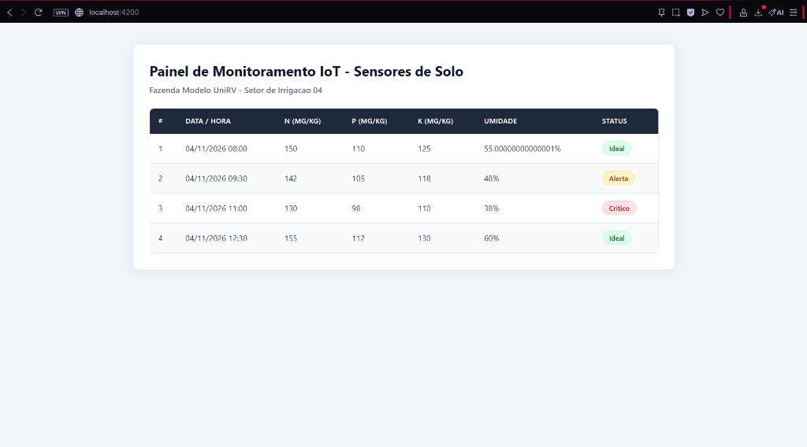

# AgroMonitor IoT - Sensores de Solo 🌾📊

Projeto prático desenvolvido para a disciplina de **Desenvolvimento Web** na **UniRV – Universidade de Rio Verde** (Faculdade de Engenharia de Software / Ciência da Computação).
**Professor:** Me. Sergio Souza Novak

---

## 👨‍🎓 Integrantes do Projeto

* **Pedro Lucas Souza Barros**
* **Kawã Santos Silva**

---

## 🚀 Sobre o Projeto

Aplicação Web desenvolvida em **Angular** para visualização e monitoramento de dados de telemetria agrícola coletados por sensores IoT em lavouras. A interface apresenta medições físico-químicas de solo essenciais:
* **Nitrogênio (N)** em mg/kg
* **Fósforo (P)** em mg/kg
* **Potássio (K)** em mg/kg
* **Umidade do Solo (%)**
* **Data e Hora da Leitura**
* **Status Operacional** (*Ideal*, *Alerta*, *Crítico*)

---

## 📸 Demonstração / Captura de Tela

Abaixo está a captura de tela da tabela de sensores renderizada no navegador em `http://localhost:4200`:



---

## 🛠️ Tecnologias Utilizadas

* **[Angular](https://angular.dev/)**
* **[TypeScript](https://www.typescriptlang.org/)**
* **HTML5 & CSS3 Moderno** (com estilização em tabela zebra, cantos arredondados e badges informativos)
* **Angular CLI**

---

## ⚙️ Pré-requisitos

Antes de iniciar, certifique-se de ter instalado em sua máquina:
* **[Node.js](https://nodejs.org/)** (v18 ou superior)
* **npm** (gerenciador de pacotes)
* **[Angular CLI](https://angular.dev/tools/cli)** (`npm install -g @angular/cli`)

---

## 📦 Como Instalar e Executar

Siga os passos abaixo para rodar o projeto localmente:

### 1. Clonar o repositório
```bash
git clone https://github.com/<seu-usuario>/agro-sensor-web.git
cd agro-sensor-web
```

### 2. Instalar as dependências
```bash
npm install
```

### 3. Iniciar o servidor de desenvolvimento
```bash
ng serve
```
ou utilizando o script npm:
```bash
npm start
```

### 4. Acessar a aplicação
Abra seu navegador e acesse:
```
http://localhost:4200
```

---

## 📁 Estrutura de Arquivos Principais

```
agro-sensor-web/
├── src/
│   ├── app/
│   │   ├── interfaces/
│   │   │   └── sensores.interface.ts     # Interface tipada LeituraSolo
│   │   ├── container-tabela/
│   │   │   ├── container-tabela.ts       # Lógica e dados de teste dos sensores
│   │   │   ├── container-tabela.html     # Template com interpolação e diretivas
│   │   │   └── container-tabela.css      # Estilização com efeito zebra e badges
│   │   ├── app.ts                        # Componente raiz com import do container
│   │   └── app.html                      # Inserção da tag <app-container-tabela>
│   └── styles.css                        # Estilos globais da aplicação
└── README.md
```
